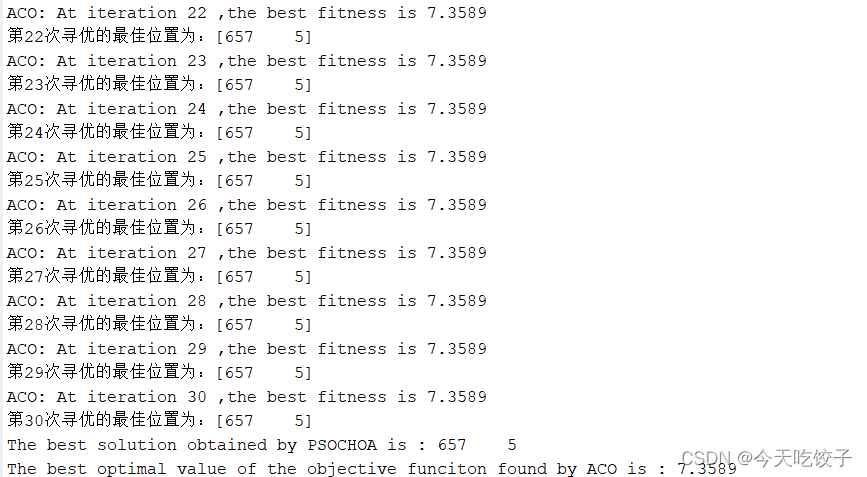
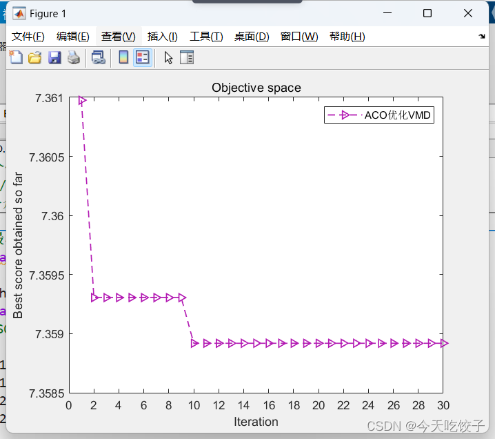

# Ant Colony Algorithm ACO, Optimizing VMD, Fitness Function is Minimal Entropy of Package, Includes MATLAB Source Code

The same example is taken from the Xichu University dataset, using data from X105_BA_time.mat.
Firstly, perform VMD decomposition, and employ the Ant Colony Optimization (ACO) algorithm to optimize two key parameters of VMD (penalty factor α and mode decomposition number K), with minimum envelop entropy as the fitness value.
As usual, first show the result:
Edit
During the experiment, the minimum envelop entropy value and the two best parameters corresponding to VMD after each optimization will be displayed in real-time. In this optimization, there are a total of 30 iterations (you can change the number of iterations at your own discretion).
After 30 iterations, the minimum envelop entropy is 7.3589, and the two best parameters for VMD are 657, 5, where the penalty factor is 657 and the mode decomposition number is 5.
The convergence curve is shown below:
Edit
Code:
%%\n%% The objective function is the minimum entropic wrapper, and the ACO algorithm is used to optimize VMD to find the optimal two parameters of VMD.\nclear all\nclc\naddpath(genpath(pwd))\nload 105.mat\nD=2;             % Optimize the number of variables\npopmin1 = 100;   % penalty factor\npopmax1 = 2500;\npopmin2 = 3;   %Modal Decomposition K-value\npopmax2 = 10;\n\nT=30;       % Maximum number of iterations\nN=20;       % Population size\ny=@Cost;\nda = X105_DE_time(1:2048); % Here, select the DE data of 105\n[AcoBest_pos,AcoBest_score,ACO_curve] = ACO(y,popmin1,popmax1,popmin2,popmax2,N,T,da);\n\n%Draw fitness function graph\nfigure\nplot(1:T,ACO_curve,'Color',[0.7 0.1 0.7],'Marker','>','LineStyle','--','linewidth',1);\n\ntitle('Objective space')\nxlabel('Iteration');\nset(gca,'xtick',0:2:T);\nylabel('Best score obtained so far');\nlegend('ACOOptimizationVMD')\ndisplay(['The best solution obtained by ACO is : ', num2str(round(AcoBest_pos))]);  % Output the best location\ndisplay(['The best optimal value of the objective funciton found by ACO is : ', num2str(AcoBest_score)]);  % Output the best fitness value\n​  

## Images

<!-- PAYMENT_BLOCK -->

## Get this dataset

- Payment link (Stripe): [Buy now](https://buy.stripe.com/3cs8yP7sY87d0vu9AB)
- Payment QR code: 

<!-- /PAYMENT_BLOCK -->
